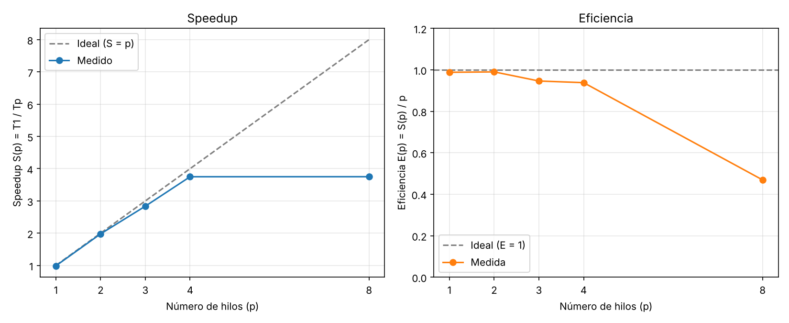

# Montecarlo con OpenMP

Estimación de π con el método de Monte Carlo, en versión secuencial y paralela (OpenMP).

Se generan `N` puntos aleatorios `(x, y)` en el cuadrado unitario `[0,1)²`. La fracción de puntos que cae dentro del cuarto de círculo (`x² + y² ≤ 1`) aproxima π/4, por lo tanto:

```
π ≈ 4 · dentro / N
```

## Archivos

| Archivo | Descripción |
|---|---|
| `montecarlo_secuencial.c` | Versión secuencial (línea base para medir el speedup). |
| `montecarlo_paralelo.c` | Versión paralela con OpenMP (`parallel for` + `reduction`). |
| `Makefile` | Compila ambas versiones (`make`) y lanza verificación, benchmark y gráficas. |
| `verificar.sh` | Comprueba que la versión paralela da el mismo `dentro` que la secuencial para varios `p`. |
| `benchmark.sh` | Mide T1 y Tp (mediana de R repeticiones) y calcula speedup y eficiencia. |
| `graficar.py` | Genera `resultados/speedup_eficiencia.png` a partir de `resultados/resumen.csv`. |
| `BITACORA_IA.md` | Bitácora del uso de IA en el examen. |
| `resultados/` | Mediciones (`tiempos.csv`), resumen (`resumen.csv`) y gráfica. |

Ambas usan el **mismo generador pseudoaleatorio** (tipo SplitMix64), donde cada número depende solo del índice de la iteración y de la semilla. Por eso:

- El resultado **no depende del número de hilos** (`p`).
- Con la misma semilla y el mismo `N`, la versión secuencial y la paralela dan exactamente el mismo valor de `dentro`, lo que permite validar la paralelización.

## Requisitos

- `gcc` con soporte OpenMP (en Linux ya viene incluido; en macOS: `brew install gcc` y usar `gcc-14` o similar en lugar de `gcc`).

## Compilar

```bash
make            # compila ambas versiones
```

O a mano:

```bash
gcc -O2 -o montecarlo_secuencial montecarlo_secuencial.c
gcc -O2 -fopenmp -o montecarlo_paralelo montecarlo_paralelo.c
```

## Ejecutar

```bash
./montecarlo_secuencial [N] [semilla]
./montecarlo_paralelo   [N] [p] [semilla]
```

| Parámetro | Significado | Valor por defecto |
|---|---|---|
| `N` | Número de puntos | `100000000` |
| `p` | Número de hilos (solo paralelo) | `1` |
| `semilla` | Semilla del generador | `20261018` |

Ejemplos:

```bash
# Secuencial con 100 millones de puntos
./montecarlo_secuencial 100000000

# Paralelo con 4 hilos
./montecarlo_paralelo 100000000 4

# Barrido de hilos para calcular speedup
for p in 1 2 4 8; do ./montecarlo_paralelo 100000000 $p; done
```

Salida de ejemplo:

```
p=4 N=100000000 pi=3.141241 dentro=78531024 tiempo=0.2164 s
```

## Speedup y eficiencia

Con `T1` = tiempo de la versión secuencial y `Tp` = tiempo con `p` hilos:

```
Speedup    S(p) = T1 / Tp
Eficiencia E(p) = S(p) / p
```

Para resultados fiables, repite cada medición varias veces y usa la mediana. Procura no tener otros programas pesados abiertos y no uses más hilos que núcleos físicos disponibles (`nproc`).

## Reproducir el experimento

```bash
make verificar                              # secuencial == paralelo para p = 1,2,3,4,8,16
./benchmark.sh 500000000 7                  # N = 5·10⁸, mediana de 7 repeticiones
python3 graficar.py                         # requiere matplotlib (pip install matplotlib)
```

`benchmark.sh` acepta `[N] [R] [semilla] ["lista de hilos"]`; por defecto prueba `p = 1 … nproc` y `2·nproc`.

## Resultados

**Entorno:** Intel Xeon @ 2.10 GHz, 4 núcleos físicos (1 hilo por núcleo), Linux, `gcc 13.3 -O2 -fopenmp`.
**Parámetros:** `N = 500 000 000` puntos, semilla `20261018`, mediana de 7 repeticiones.

### Validación

Todas las ejecuciones (secuencial y paralelas con cualquier `p`) dieron exactamente
`dentro = 392 677 373` → **π ≈ 3.141419**. El error absoluto es ≈ 1.7·10⁻⁴, unas 2.3 veces
el error estándar del estimador (4·√(q(1−q)/N) ≈ 7.3·10⁻⁵ con q = π/4), coherente con la
convergencia O(1/√N) de Monte Carlo. La paralelización no altera el resultado.

### Tiempos, speedup y eficiencia

T1 (secuencial) = **1.5564 s**

| p | Tp (s) | Speedup S(p) | Eficiencia E(p) |
|---:|---:|---:|---:|
| 1 | 1.5747 | 0.99 | 0.99 |
| 2 | 0.7864 | 1.98 | 0.99 |
| 3 | 0.5486 | 2.84 | 0.95 |
| 4 | 0.4150 | 3.75 | 0.94 |
| 8 | 0.4149 | 3.75 | 0.47 |



### Análisis

- **Escalabilidad casi lineal hasta el número de núcleos.** Con 4 hilos se obtiene S ≈ 3.75
  (E ≈ 94 %). El problema es *embarrassingly parallel*: cada iteración es independiente,
  no hay estado compartido (el generador depende solo de `i` y de la semilla) y la única
  sincronización es la `reduction(+:dentro)` final, que cuesta O(p).
- **Overhead con p = 1.** La versión paralela con 1 hilo es ~1 % más lenta que la secuencial
  por la creación del equipo de hilos y la reducción; es despreciable frente a N = 5·10⁸.
- **Pérdida de eficiencia de 2 → 4 hilos (99 % → 94 %).** Se debe a factores del sistema
  (otros procesos compitiendo por los núcleos, frecuencia de reloj compartida, desbalance
  pequeño al repartir en bloques con `schedule(static)` por defecto), no al algoritmo.
- **Sobresuscripción (p = 8 > 4 núcleos).** El tiempo no mejora (0.415 s ≈ p = 4): solo hay
  4 núcleos, así que los hilos extra se turnan en ellos y la eficiencia cae a la mitad.
  Conviene no usar más hilos que núcleos físicos (`nproc`).
- **Ley de Amdahl.** La fracción secuencial (lectura de argumentos, reducción, `printf`) es
  prácticamente nula, por lo que el límite de speedup viene dado por el hardware (número de
  núcleos) y no por la parte serial del programa.

### Conclusión

La paralelización con `#pragma omp parallel for reduction(+:dentro)` es correcta (mismo
resultado que la versión secuencial para cualquier número de hilos) y eficiente: alcanza un
speedup de 3.75 con 4 núcleos (94 % de eficiencia). Más hilos que núcleos no aportan mejora.

> Los tiempos dependen de la máquina. Para el informe, vuelve a ejecutar `./benchmark.sh`
> en tu equipo y actualiza esta sección con tus valores.

## Semilla

La semilla por defecto está definida en `SEMILLA_DEFECTO` dentro de cada `.c`. Cámbiala por la que te asignó el docente, o pásala por línea de comandos como último argumento.
