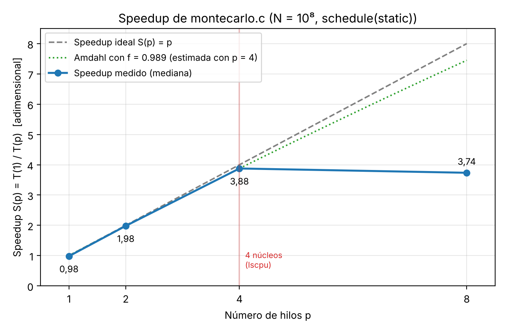

# Parte III. Evaluación de desempeño: speedup y ley de Amdahl (30 %)

Todos los valores de esta sección salen de mediciones reales (`resultados/tiempos_speedup.csv`) y
fueron calculados por `scripts/analisis.py` (`resultados/analisis.json`, `resultados/amdahl.md`).

## Equipo y protocolo

| Elemento | Valor (de `resultados/equipo.txt`) |
|---|---|
| Sistema operativo | Ubuntu 24.04.5 LTS, kernel Linux 6.18 (máquina virtual KVM en la nube) |
| CPU | Intel Xeon Processor @ 2,10 GHz (modelo 207), 1 socket |
| Núcleos | 4 CPU lógicas = 4 núcleos × 1 hilo por núcleo según `lscpu` (son vCPU: no sabemos cómo se asignan a núcleos físicos del anfitrión) |
| Caché | L1d 48 KiB/núcleo, L2 2 MiB/núcleo, L3 260 MiB compartida |
| Memoria | 15 GiB |
| Compilador | gcc 13.3.0, `-O2 -fopenmp`, OpenMP 4.5 (`_OPENMP 201511`), glibc 2.39 |
| Programa | `montecarlo.c`, `schedule(static)`, semilla 20261018 |

**Protocolo:** $N = 10^8$ fijo; $p \in \{1, 2, 4, 8\}$; 7 ejecuciones por configuración
(mínimo pedido: 5), más una de calentamiento no registrada. Las ejecuciones se **intercalan**
(una de cada configuración por ronda, con el orden rotado) para que una perturbación pasajera de
la máquina no afecte solo a una configuración. Se registran todos los tiempos individuales y se
usa la **mediana**. Todas las ejecuciones dieron `dentro = 78 540 833` (verificado por el
script).

**¿Por qué la mediana y no el promedio?** En un sistema compartido, el ruido (otros procesos,
interrupciones, migración de hilos, la máquina virtual) solo puede **sumar** tiempo: hay un
mínimo físico y una cola de valores atípicos hacia arriba. El promedio se desplaza con cada valor
atípico, mientras que la mediana no. Ejemplo real: en el experimento de II.5, con $p = 4$ y
`static`, una ejecución tardó 0,280 s frente a una mediana de 0,238 s; esa sola medición sube el
promedio sin representar el comportamiento típico del programa.

**¿Qué es $T(1)$?** Usamos la mediana de la **versión secuencial real** (`montecarlo_secuencial`,
mismo $N$, mismo generador, mismo ciclo y la misma forma de medir con `omp_get_wtime()`), como
pide II.1. Así el speedup mide la ganancia real frente al mejor programa secuencial disponible.
También medimos `montecarlo` con $p = 1$: es un 2,0 % más lento (0,8908 frente a 0,8735 s) por la
sobrecarga de la región paralela y el recorrido por bloques. Esa diferencia es del orden de la
dispersión de las mediciones (0,860–0,896 s frente a 0,860–0,915 s). Usar la versión OpenMP con
$p = 1$ como $T(1)$ inflaría un poco el speedup (columna "S vs OpenMP p=1" en
`resultados/tabla_speedup.csv`).

## Tabla experimental

$N = 10^8$, semilla 20261018, `schedule(static)`. $\pi$ estimado = 3,14163332 en **todas** las
filas (error absoluto $4{,}07\cdot10^{-5}$).

| $p$ (hilos) | Tiempos individuales [s] | Mediana de $T(p)$ [s] | $S(p)=T(1)/T(p)$ | $E(p)=S(p)/p$ |
|---|---|---:|---:|---:|
| 1 (secuencial) | 0,8888 · 0,8735 · 0,8601 · 0,8720 · 0,8648 · 0,8963 · 0,8865 | **0,8735** | 1,000 | 1,000 |
| 1 (OpenMP) | 0,8912 · 0,8855 · 0,8908 · 0,8603 · 0,9094 · 0,8675 · 0,9152 | **0,8908** | 0,981 | 0,981 |
| 2 | 0,4590 · 0,4612 · 0,4408 · 0,4246 · 0,4601 · 0,4404 · 0,4291 | **0,4408** | 1,982 | 0,991 |
| 4 | 0,2345 · 0,2306 · 0,2276 · 0,2228 · 0,2253 · 0,2155 · 0,2150 | **0,2253** | 3,877 | 0,969 |
| 8 | 0,2483 · 0,2411 · 0,2275 · 0,2338 · 0,2338 · 0,2344 · 0,2263 | **0,2338** | 3,735 | 0,467 |

Gráfica: `resultados/speedup.png` (speedup medido, recta ideal $S = p$ y la curva de Amdahl con
la $f$ estimada).

---

## III.1. Ley de Amdahl en tres casos

$$S(p) = \frac{1}{(1-f) + f/p}$$

**(a) $f = 0{,}98$, $p = 8$:**
$S = \dfrac{1}{0{,}02 + 0{,}98/8} = \dfrac{1}{0{,}02 + 0{,}1225} = \dfrac{1}{0{,}1425} = \mathbf{7{,}02}$
→ eficiencia $7{,}02/8 = 0{,}877$. Con solo un 2 % de código secuencial ya se pierde el 12 % de
la máquina con 8 procesadores.

**(b) $f = 0{,}90$, $p = 8$:**
$S = \dfrac{1}{0{,}10 + 0{,}90/8} = \dfrac{1}{0{,}10 + 0{,}1125} = \dfrac{1}{0{,}2125} = \mathbf{4{,}71}$
→ eficiencia 0,588. Pasar de 2 % a 10 % de parte secuencial reduce el speedup de 7,0 a 4,7: con
8 hilos, la parte secuencial (0,10) ya tarda casi lo mismo que toda la parte paralela (0,1125).

**(c) $f = 0{,}98$, $p \to \infty$:**
$S_\infty = \lim_{p\to\infty} \dfrac{1}{0{,}02 + 0{,}98/p} = \dfrac{1}{0{,}02} = \mathbf{50}$.

**Lección del caso (c):** el speedup máximo está acotado por $1/(1-f)$, **sin importar cuántos
procesadores se agreguen**. Con infinitos procesadores la parte paralela tarda cero, pero la
secuencial sigue tardando lo mismo. Un 2 % de código secuencial, que parece insignificante, limita
el programa a 50× para siempre. Por eso, para escalar a muchos procesadores, reducir la fracción
secuencial importa más que agregar hardware.

---

## III.2. Estimación de $f$ con el speedup medido para $p = 4$

**Despeje:**

$$S = \frac{1}{(1-f) + f/p}
\;\Rightarrow\; \frac1S = 1 - f + \frac fp = 1 - f\Big(1 - \frac1p\Big)
\;\Rightarrow\; \boxed{f = \frac{1 - 1/S}{1 - 1/p}}$$

**Sustitución** con $S(4) = 0{,}8735 / 0{,}2253 = 3{,}877$:

$$f = \frac{1 - 1/3{,}877}{1 - 1/4} = \frac{1 - 0{,}2579}{0{,}75} = \frac{0{,}7421}{0{,}75} = \mathbf{0{,}9895}
\qquad\Rightarrow\qquad 1 - f = \mathbf{0{,}0105}\;(1{,}05\,\%).$$

El valor está en $[0, 1]$ y es físicamente interpretable: según Amdahl, el 98,9 % del trabajo se
comporta como paralelizable y el 1,05 % como secuencial.

**Métrica de Karp–Flatt:**

$$e(p) = \frac{1/S(p) - 1/p}{1 - 1/p}$$

| $p$ | $S(p)$ | $e(p)$ |
|---:|---:|---:|
| 2 | 1,982 | 0,0092 |
| 4 | 3,877 | 0,0105 |
| 8 | 3,735 | 0,1631 |

Con un solo $p$, $e$ coincide algebraicamente con $1 - f$ (0,0105 con $p = 4$). Su utilidad está
en **ver cómo cambia con $p$**. Si $e$ fuera constante, la pérdida se debería a una fracción
secuencial fija (Amdahl puro). Si $e$ crece con $p$, hay una **sobrecarga paralela** que aumenta
con el número de hilos (sincronización, comunicación, contención o falta de núcleos), algo que
Amdahl no modela. Nuestros datos muestran $e \approx 0{,}01$ casi constante para $p = 2$ y $4$,
y un salto a 0,16 con $p = 8$. Ese salto no es una fracción secuencial: es la falta de núcleos
(ver III.3).

**¿Qué es realmente ese 1 %?** En la región medida, lo estrictamente secuencial (crear el equipo
de hilos, repartir 1 526 bloques, la reducción de 4 valores, la barrera final) cuesta del orden de
microsegundos, mientras que el 1,05 % de 0,87 s son unos 9 ms. Además, el desbalance de carga de
`static` es mínimo (382 frente a 381 bloques por hilo, ≈ 0,13 %). Por tanto, la "fracción
secuencial" estimada **no es código secuencial**: recoge otros efectos que Amdahl no distingue,
como la sobrecarga de la versión OpenMP frente a la secuencial (+2,0 % con $p = 1$) y la variación
del equipo. Si se toma como referencia la versión OpenMP con $p = 1$, el speedup con 4 hilos es
3,954 y $e(4) = 0{,}0039$, menos de la mitad.

---

## III.3. Speedup ideal, medido y predicho por Amdahl ($f = 0{,}9895$)

| $p$ | Ideal $S = p$ | Medido | Amdahl con $f = 0{,}9895$ | Medido / Amdahl |
|---:|---:|---:|---:|---:|
| 1 | 1 | 0,981 | 1,000 | 0,98 |
| 2 | 2 | 1,982 | 1,979 | 1,00 |
| 4 | 4 | 3,877 | 3,877 (ajustado aquí) | 1,00 |
| 8 | 8 | 3,735 | 7,450 | 0,50 |

**Hasta 4 hilos el programa escala casi idealmente** (eficiencia 0,99 con $p = 2$ y 0,97 con
$p = 4$) y Amdahl describe bien los datos. **Con 8 hilos la discrepancia es enorme** (3,7
frente a 7,5).

Causas **observadas** (respaldadas por nuestras mediciones):

1. **Disponibilidad real de núcleos.** La máquina tiene 4 CPU (`nproc = 4`). Con 8 hilos, el
   sistema operativo alterna dos hilos por núcleo: el trabajo total es el mismo y la capacidad de
   cómputo también, así que $T(8) \approx T(4)$ (0,2338 frente a 0,2253 s). Amdahl supone $p$
   procesadores reales; con $p >$ núcleos, su predicción no aplica. El 3,8 % adicional de
   $T(8)$ es el costo de los cambios de contexto y de que el más lento de los 8 hilos determina
   el final.
2. **Sobrecarga de la versión paralela con un hilo:** +2,0 % (0,8908 frente a 0,8735 s), del
   orden de la dispersión.
3. **Ruido experimental:** los tiempos individuales con $p = 4$ van de 0,2150 a 0,2345 s (±4 %).
   Con el mínimo, el speedup daría 4,06, por encima del ideal, lo cual es imposible y confirma
   que hay ruido. Por esto se usa la mediana. Antes de esta implementación, con la variante
   SplitMix64 (`src/variantes/`) en la misma máquina virtual, tres series con $N = 10^8$ dieron
   $S(4)$ entre 2,9 y 3,96 (ver bitácora): la VM comparte el anfitrión con otros procesos.

Factores **descartados o despreciables**, con su razón:

4. **Creación y destrucción de hilos:** libgomp crea los hilos una vez y los reutiliza; el costo
   es de decenas de microsegundos frente a 225 ms (< 0,05 %).
5. **Costo de la reducción:** $p$ sumas de enteros al final: despreciable.
6. **Generación de números aleatorios:** cada hilo tiene su estado en un registro; no hay
   contención. El salto inicial por bloque (1 526 saltos de ~30 multiplicaciones) es despreciable.
   En cambio, *compartir* el generador sí destruiría el speedup (II.3: hasta 18× más lento).
7. **Ancho de banda de memoria y jerarquía de caché:** el cálculo no lee ni escribe arreglos.
   Todo cabe en registros y en L1, así que no hay tráfico de memoria que saturar. Es un problema
   limitado por cómputo, y por eso escala tan bien hasta 4 hilos. Las copias privadas de la
   reducción viven en la pila de cada hilo, de modo que tampoco hay *false sharing* en el ciclo.

**Hipótesis plausibles no verificadas:**

8. **Frecuencia variable del procesador:** muchos Xeon bajan la frecuencia turbo cuando hay
   más núcleos activos, lo que reduciría la eficiencia al pasar de 1 a 4 núcleos (podría explicar
   parte del 3 % que se pierde con $p = 4$). En la VM no tenemos acceso a la frecuencia real
   (`lscpu` no informa MHz dinámicos), así que no se pudo verificar.
9. **Hiperprocesamiento:** `lscpu` informa 1 hilo por núcleo, pero en una VM las 4 vCPU podrían
   estar asignadas a hilos hermanos de un mismo núcleo físico del anfitrión. Si fuera así, el
   speedup con 4 hilos sería claramente menor que 4; como obtuvimos 3,88, todo indica que son
   núcleos reales, aunque no podemos asegurarlo.

---

## III.4. Proyección a una máquina de 64 núcleos

Con $f = 0{,}9895$:

$$S(64) = \frac{1}{0{,}0105 + 0{,}9895/64} = \frac{1}{0{,}0105 + 0{,}01546} = \frac{1}{0{,}0260} = \mathbf{38{,}5}
\qquad E(64) = 0{,}60
\qquad S_\infty = \frac{1}{0{,}0105} = 94{,}8.$$

Con $N$ fijo, 64 núcleos darían como máximo ≈ 38× (60 % de eficiencia). Con 64 hilos, la parte
"secuencial" (1,05 %) ya tarda casi lo mismo que la paralela (1,55 %).

**Sensibilidad:** la proyección es muy sensible al $S(4)$ medido, porque extrapola de 4 a 64:

| $S(4)$ medido | $f$ | $S(64)$ | $S_\infty$ |
|---:|---:|---:|---:|
| 3,750 | 0,9778 | 26,7 | 45 |
| **3,877 (nuestro)** | **0,9895** | **38,5** | **95** |
| 3,950 | 0,9958 | 50,6 | 237 |

Una diferencia de 5 % en $S(4)$ cambia la predicción para 64 núcleos casi al doble. Lo correcto
sería medir de nuevo en la máquina de 64 núcleos (con varios sockets, NUMA o hiperprocesamiento,
los efectos pueden ser otros).

**¿En qué se diferencia de crecer $N$?** Amdahl supone **$N$ fijo**. En Monte Carlo el trabajo
paralelo crece con $N$, mientras que la parte que no escala es casi constante. De $T(1)$ y $T(4)$:

$$T(1) = t_s + t_{par},\quad T(4) = t_s + t_{par}/4 \;\Rightarrow\; t_s = \frac{4T(4) - T(1)}{3} = 9{,}2\text{ ms},\quad t_{par} = 864\text{ ms}.$$

Si $N$ se multiplica por $k$, $t_{par}$ se multiplica por $k$ y $t_s$ no, así que $f$ crece:

| $N$ | $f$ | $S(64)$ |
|---:|---:|---:|
| $10^8$ | 0,9895 | 38,5 |
| $10^9$ (×10) | 0,9989 | 60,0 |
| $10^{10}$ (×100) | 0,99989 | 63,6 |

Aumentar el problema hace que la máquina grande se aproveche mejor (ver III.5).

**Reflexión: ¿$p$ mejora la precisión o solo el tiempo?** Con $N$ fijo, aumentar $p$ **solo
mejora el tiempo**. Como se demostró en I.3, el estimador es el mismo; en nuestra implementación
incluso el resultado es idéntico bit a bit (`dentro = 78 540 833` para todo $p$). El error típico
depende únicamente de $N$: $\sigma = 1{,}64/\sqrt N$.

- **$p$ mejora el tiempo:** el mismo cálculo termina hasta $S(p)$ veces antes.
- **$N$ mejora la precisión:** el error típico baja como $1/\sqrt N$, a costa de un tiempo que
  crece linealmente con $N$.

**Combinadas**, los núcleos se pueden usar para "comprar" precisión: en el mismo tiempo de pared
que la versión secuencial con $N = 10^8$ (0,87 s), 64 núcleos procesarían del orden de
$38{,}5 \times 10^8$ muestras (más, porque $f$ crece con $N$), reduciendo el error típico unas
$\sqrt{38{,}5} \approx 6{,}2$ veces (hasta $\sqrt{64} = 8$ veces en el mejor caso). Ni siquiera
así se gana un dígito completo, que requiere 100 veces más muestras. **Limitación de nuestra
implementación:** el flujo de `rand_r` admite como máximo $N = 715\,827\,882$ muestras sin
repetirse (II.2), así que para $N \ge 10^9$ habría que cambiar a un generador de período mayor.

---

## III.5 (opcional). Por qué Amdahl puede ser pesimista: Gustafson

Amdahl responde a la pregunta *"¿cuánto más rápido resuelvo **el mismo problema**?"* (escalado
fuerte). En la práctica, con más procesadores se suele resolver **un problema más grande en el
mismo tiempo** (escalado débil): en Monte Carlo, más muestras para mayor precisión.

**Ley de Gustafson.** Sea $\alpha$ la fracción del tiempo **de la ejecución paralela** que es
secuencial. Si la parte paralela se ejecutara en un solo procesador, tardaría $p$ veces más:

$$S_G(p) = \frac{\alpha + p(1-\alpha)}{\alpha + (1-\alpha)} = \alpha + p\,(1-\alpha) = p - \alpha\,(p - 1).$$

| | Amdahl | Gustafson |
|---|---|---|
| Qué se fija | El tamaño del problema ($N$) | El tiempo de ejecución |
| Fracción serial | $1-f$, medida sobre el tiempo **secuencial** | $\alpha$, medida sobre el tiempo **paralelo** |
| Al crecer $p$ | La parte serial pesa cada vez más → techo $1/(1-f)$ | El trabajo paralelo crece con $p$ → $S$ crece linealmente, sin techo |

**Con nuestros datos:** $\alpha = t_s / T(4) = 9{,}2/225{,}3 = 0{,}041$ y
$S_G(64) = 0{,}041 + 64 \times 0{,}959 = \mathbf{61{,}4}$, frente a 38,5 de Amdahl con $N$ fijo.
Ambas leyes son correctas, pero responden a preguntas distintas. Amdahl es pesimista solo si en
realidad vamos a aprovechar los procesadores adicionales para hacer más trabajo, que es justo lo
que conviene en Monte Carlo. La tabla de III.4 ($S(64) \to 63{,}6$ con $N$ ×100) muestra el mismo
fenómeno desde el punto de vista de Amdahl.
